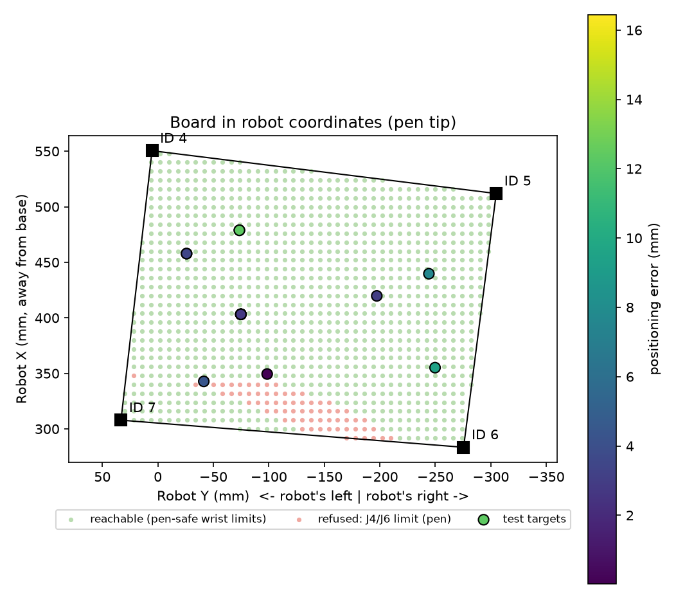
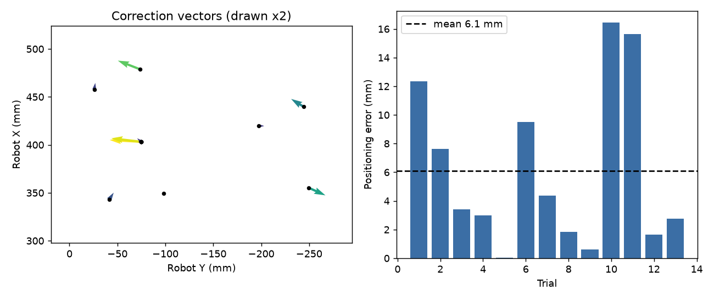

# AR4 MK4 – Team 2 Vision-Guided Positioning

This program uses a webcam to find a target on the board and drives an Annin
Robotics AR4 MK4 arm so the pen pointer taped to J6 hovers over it (and,
optionally, touches it). Move the target and the commanded position follows the
camera. Every move is checked before it is sent: uncertain detections and
unreachable targets are refused, and all motion runs at low, fixed speed.

This is **Checkpoint 1** of the vision-guided AR4 chess assignment.

**Demonstration videos:** *(add YouTube links)*
- Camera-guided moves to several target positions: `https://youtu.be/...`
- Failure handling (covered marker, two targets, stop, E-stop and recovery): `https://youtu.be/...`



*The board in robot coordinates. The four ArUco markers were taught by touching
each one with the pen. Green is reachable, red is refused because the wrist
would roll the taped pen too far. The circles are test targets, coloured by
measured positioning error.*

## Contents

| File | Purpose |
|---|---|
| `vision_demo.py` | Main program. Live camera view, target detection, safety checks and the move sequence. Logs every move to `results/moves.csv`. |
| `teach.py` | Jog tool for teaching the calibration: pen tip on each marker centre, plus a PARK pose. Writes `calib.json`. |
| `check_limits.py` | Limit test to run before camera-generated moves: software rejections, a firmware refusal, and hovering over every marker. |
| `vision.py` | Camera discovery, ArUco board mapping (pixel to robot X/Y), coloured-target detection, stability filter. |
| `kin.py` | Simulates each move with Annin's own kinematics: reach, joint limits, pen-safe wrist limits, wrist singularity. |
| `ar4link.py` | Serial library for the AR4 Teensy (Annin firmware 6.7.1). Every read has a timeout; detects the E-stop flag; guards each move. |
| `override.py` | Operator override: the third repeat of a refused action is sent anyway. |
| `refine.py` | Optional: fits a correction to the mapping from measured trials. |
| `analyze.py` | Turns `results/moves.csv` into error and repeatability tables (`results/summary.md`) and `results/errors.png`. |
| `camera_check.py` | Live view with marker overlay, for aiming the camera. |
| `config.py` | All settings: camera, target colour, heights, speed, safety margins. |
| `calib.json` | Our taught calibration (four marker positions, board plane, PARK). |
| `config/ARconfig.json` | Snapshot of the AR4 HMI configuration used: DH parameters, joint limits, calibration. |
| `firmware/` | Annin Teensy 4.1 firmware v6.7.1, unmodified, with Annin's license. |
| `docs/` | Figures for this README and the report (`make_figures.py` regenerates them). |
| `results/` | Test log, summary and plot. `results/archive/` holds earlier calibrations. |
| `requirements.txt` | Python dependencies. |
| `CONTRIBUTIONS.md` | Team member contributions. |

## Hardware and software

- **Robot:** Annin Robotics AR4 MK4, Teensy 4.1 controller.
- **Firmware:** Annin `AR4_teensy41_sketch_v6.7.1`, unmodified.
- **Calibration:** Annin AR4 HMI 6.7 (`AR4.py`), using Auto Calibrate. Its
  kinematics module (`ARrobots.robot_kinematics`) is also used by `kin.py`.
- **Camera:** Logitech C930e USB webcam at 1280 × 720, fixed above the far side
  of the board, looking toward the robot.
- **Board:** foam mat with four ArUco markers (dictionary `DICT_4X4_50`, IDs 4–7).
- **Target:** a flat pink paper square (about 40 × 40 mm).
- **End effector:** a pen taped to the J6 flange, used as a pointer.
- **Host:** Ubuntu 24.04 (aarch64) in a Parallels VM, Python 3.12, OpenCV 5.0,
  with the Teensy and the webcam passed through to the VM.

## Coordinate frame

Positions are in the robot base frame, in mm:

- **+X:** away from the base.
- **+Y:** the robot's left.
- **+Z:** up.

The pen's orientation is held fixed for every move (Rz 0°, Ry 170°, Rx 0°:
pointing down, tilted 10°). Because it never changes, the offset from the J6
flange to the pen tip is a constant that the taught points already include, so
the pen length never has to be measured.

## Camera-to-robot mapping

1. **Teach:** with `teach.py`, the pen tip is jogged until it just touches the
   centre of each marker, and the robot position is saved. The robot itself
   measures the board, so there is no tape-measure step.
2. **Map:** in every camera frame the four marker centres are detected. A
   homography maps their pixel positions onto the four taught robot X/Y
   positions. The board is flat, so this maps any pixel on the board to robot
   X/Y. Recomputing it every frame means a slightly bumped camera does not break
   the calibration (a moved board or robot does).
3. **Height:** a plane `z = a·x + b·y + c` is fitted through the four taught
   touch heights (fit residual ±0.7 mm). Hover and travel heights are measured
   from this plane.
4. **Target centre:** the target's outline is projected into robot coordinates
   first and its centroid taken there, which removes the perspective bias of a
   pixel centroid.

## Running on a new robot from scratch

### A. Install the Python dependencies

```bash
cd team2_vision
python3 -m venv venv
venv/bin/pip install -r requirements.txt
```

- **Serial access:** add your user to the `dialout` group (`sudo usermod -aG dialout $USER`), then log out and back in.
- **Tk for the jog tool:** if `import tkinter` fails, run `sudo apt install python3-tk`.
- **VM:** pass both the Teensy and the webcam through to the VM. In Parallels,
  use **Devices → USB & Bluetooth**. Use the webcam's direct USB device; the
  Parallels virtual copy of the camera does not deliver frames. The programs
  find the right one by name.

### B. Flash the firmware

The program needs Annin firmware **6.7.1**, which is in `firmware/`. Follow the
same steps as in our writing project
([AR4_MK4_Team-Writing](https://github.com/BengalPirate/AR4_MK4_Team-Writing)):
Arduino IDE or `arduino-cli`, board **Teensy 4.1**, library **ModbusMaster**.

### C. Install the Annin AR4 HMI 6.7

Download **AR4 HMI 6.7** from https://www.anninrobotics.com. Put it at
`~/AR4/AR4 HMI Interface 6.7 source`, or set `AR4_HMI_DIR` to its folder.
`kin.py` loads its kinematics module and `ARconfig.json` from there.

### D. Check the arm

Jog each joint in the HMI, run `Test Limit Switches.ar4`, and keep the E-stop
within reach.

> **`calib.json` is specific to our robot, board, camera and pen.** On another
> setup, or if the board, robot or pen moves, **re-teach** (step 3 below).

> **Only one program can use the arm's serial port.** Close the HMI before
> running any of these tools. They refuse to start while it is open.

## How to run

### 1. Calibrate the arm

Open the AR4 HMI, press **Auto Calibrate**, wait for both stages to succeed,
then **close the HMI**.

### 2. Aim the camera

```bash
venv/bin/python camera_check.py
```

Aim and fix the camera until the banner says **ALL 4 MARKERS VISIBLE**.

### 3. Teach the board (only when the board, robot or pen moves)

```bash
venv/bin/python teach.py
```

1. **Go Home**, then press any jog button and answer **Yes** to set the pen angle (only J5 moves).
2. For markers 4, 5, 6 and 7: jog until the pen tip **just touches** the marker
   centre, looking straight down, finishing with 0.5 mm steps. **Save marker N**,
   then **Lift 30 mm**.
3. Jog above the board, clear of the camera's view of the markers, and **Save PARK**.

### 4. Test the limits

```bash
venv/bin/python check_limits.py
```

This shows that off-board, out-of-reach and below-board points are rejected,
sends one unreachable pose to show the firmware refuses it, then hovers over
each marker and parks.

### 5. Dry run (optional, no robot)

```bash
venv/bin/python vision_demo.py --dry
```

### 6. Run the demo

```bash
venv/bin/python vision_demo.py
```

Click the target in the window (this also picks its colour). When the banner
says **READY**, press **G**.

| Key (demo window focused) | Action |
|---|---|
| G | Go: rise, travel, descend to 15 mm above the target |
| T | Touch the target with the pen, then return to hover |
| I / K | Nudge the pen +X / −X by 1 mm |
| J / L | Nudge the pen +Y / −Y by 1 mm |
| E | Record the nudge from the commanded point as the positioning error |
| R | Retreat straight up |
| P | Park (also releases the board interlock) |
| SPACE | Software stop: no further moves start |
| M | Show the colour mask |
| click | Re-pick the target colour at that pixel |
| Q | Quit |

### 7. Results

```bash
venv/bin/python analyze.py
```

## How it works

1. **Detect:** the four markers must all be visible. The target is the one
   pink blob on the board whose area (150–6000 mm²) and shape (solidity ≥ 0.85)
   are plausible. Blobs more than 50 mm outside the board are ignored.
2. **Stabilise:** the target is accepted only after 15 consecutive frames agree within 3 mm.
3. **Check:** the target must be at least 15 mm inside the board, and the hover,
   touch and travel poses must be reachable within the joint limits. The banner
   shows the reason for any refusal before G is pressed.
4. **Move:**
   1. Rise to travel height (100 mm above the board; 80/60/40 mm where 100 mm is out of reach).
   2. Travel above the target.
   3. Descend to 15 mm above it.
   4. (T) Touch and return to hover.
   5. (P) Rise and return to PARK.
   Each segment is a straight-line move at 10 % speed. Where a straight line
   would pass the wrist singularity, it becomes a joint move to the same pose
   instead (see *Known issues*).
5. **Log:** every move, refusal and error measurement goes to `results/moves.csv`.

## Results

Measured by moving the pen with the camera, then nudging it until it was exactly
over the target centre. The nudge is the error. Full tables are in
`results/summary.md`.

| Measure | Result |
|---|---|
| Board plane fit (4 taught markers) | ±0.7 mm |
| Commanded vs. controller-reported position, 14 hovers | ≤ 1.0 mm |
| Detection spread when a move starts | ≤ 0.5 mm |
| Positioning error, 8 target locations | median 3.9 mm, mean 5.3 mm, max 12.3 mm |
| Repeatability, same target ×6 | 4 of 6 within 2.8 mm; 2 of 6 off by about 16 mm in +Y (see *Known issues*) |



## Safety

| Layer | What it does |
|---|---|
| Speed | Every move at 10 %; the serial library refuses anything above 25 %. |
| Detection | Moves only when all 4 markers are visible, there is exactly one target, its size and shape are plausible, and it has been steady for 15 frames. |
| Workspace | The target must be inside the marker rectangle, shrunk by 15 mm. Nothing goes below the board plane. |
| Kinematics | Before each straight-line move, `kin.py` simulates it in 2 mm steps with Annin's solver. Out of reach or past a joint limit: refused before sending. |
| Pen-safe wrist limits | J4 is limited to ±45° and J6 to −90…+45°, because the taped pen would break if the wrist rolled further. |
| Pen-angle guard | A straight-line move is refused if it would also turn the pen by more than 5°. |
| Firmware | Unreachable or out-of-limit poses are refused by the controller (`ER` / `EL`) without moving. |
| Software stop | SPACE stops the sequence before its next move. Firmware 6.7.1 cannot be interrupted over USB mid-move. |
| E-stop | The red E-stop interrupts the firmware mid-move. The program detects the `EB` flag and stops. Recovery: release, press **R** (retreat), then **P** (park). |
| Interlock | Moving over the board needs an exclusive lock file (`AR4_BOARD_LOCK`), so only one arm controller can use the board at a time. |
| Operator override | Repeating a refused action 3 times within 20 s sends it anyway, skipping our software checks. The firmware's limits still apply. Overrides are logged. |
| Port | The tools refuse to start while the HMI holds the serial port. |

Failure cases demonstrated and logged: covered marker, two targets,
target off the board / too small, unreachable target (joint limit), software
stop mid-sequence, E-stop mid-move and recovery.

## Known issues and lessons learned

- **Never hold the pen exactly vertical (Ry 180°).** The firmware reports the
  pen angle as three Euler angles, and at Ry 180° they wrap between +180° and
  −180°. Firmware 6.7.1 interpolates those angles on straight-line moves, so a
  2 mm jog became a slow full turn of the wrist. The pen is held at Ry 170°
  instead, and moves that would change the pen angle are refused.
- **Wrist singularity near the robot.** Near marker 7 the pen points almost
  along the forearm (J5 ≈ 0). There, a straight line makes the firmware swing
  J4/J6 half a turn. The program uses a joint move to the same pose instead,
  choosing the wrist solution closest to the current one, so J5 passes smoothly
  through zero.
- **Pen-safe wrist limits leave a small strip unreachable** (red in the board
  map, about 5 % of the board, between markers 6 and 7). The override can
  force a move there if the operator can see the pen has room.
- **Tilting the pen the other way (Ry −170°) was tried.** It cleared the
  singularity but moved the flange about 50 mm outward, putting the far corners
  out of reach.
- **Teaching accuracy limits the error.** A second teaching session gave
  15–18 mm errors against measured points (marker 6 was off by about 23 mm), so
  the first calibration was kept (`results/archive/`).
- **Two repeatability outliers.** Two of the six repeats at one location needed
  about 16 mm of correction in +Y, although the arm was commanded to, and
  reported, the same position within 0.1 mm. The cause is not confirmed:
  candidates are the taped pen shifting, J1 backlash, or an operator nudging
  error.
- **Never use mm/s speed with firmware 6.7.1** (see the writing project). This code always uses percent speed.

## Recovering

- **E-stop pressed mid-move:** release it, press **R**, then **P**.
- **Board not responding:** unplug the Teensy USB for 5 seconds, reconnect it,
  recalibrate in the HMI. `calib.json` stays valid.
- **Camera disconnected:** it may come back under a different `/dev/video`
  number. The programs find it by name; just restart them.

## Team

See [CONTRIBUTIONS.md](CONTRIBUTIONS.md).

## Acknowledgements

- **Annin Robotics:** firmware 6.7.1 and the AR4 HMI 6.7 kinematics module,
  used unmodified under the Annin Open Source Non-Commercial License
  (`firmware/ANNIN_LICENSE.txt`).
- **Reference:** the board and marker approach (ArUco markers 4–7, teaching by
  jogging the tool over them) follows another team's Milestone 4 work,
  [MosesJames46/Embedded-Systems-ARM4-MK4](https://github.com/MosesJames46/Embedded-Systems-ARM4-MK4).
  Our implementation is separate: a direct pixel-to-robot homography with no
  tape-measured layout, a board-plane fit, kinematic path simulation, the
  pen-angle guard and the pen-safe wrist handling.
- **Our earlier work:** `ar4link.py` and the jog tool extend our writing project,
  [BengalPirate/AR4_MK4_Team-Writing](https://github.com/BengalPirate/AR4_MK4_Team-Writing).
- **AI assistance:** the code and documentation were written with Claude
  (Anthropic) in Claude Code, directed by the team. They were tested on the
  physical robot: the limit test, live camera-guided trials, and every failure
  case listed above, as logged in `results/`.

## License

- **Annin firmware** (`firmware/`) and **configuration** (`config/ARconfig.json`):
  © Chris Annin / Annin Robotics, redistributed unmodified for non-commercial
  educational use under `firmware/ANNIN_LICENSE.txt`.
- **Our code** (`*.py`): written by Team 2 for this course assignment.
